# homelab

Infrastructure as code for a self-hosted homelab: a Proxmox hypervisor, a Talos
Linux Kubernetes cluster, and Flux-managed workloads, provisioned with OpenTofu
and Ansible. Every line was written by Claude Code. The interesting part is not
the cluster but the gate in front of it: **every mistake the AI made became an
automated guard, proved to fail when the mistake comes back, so it cannot
happen twice.** Reviewing a diff is not trusted to catch the next one; a test
is.

## How it works

A change passes three gates. Each stops only what it is the cheapest place to
stop, and the push gate is held to a ten-second budget so nobody is tempted to
skip it.

```mermaid
flowchart LR
    W["Claude Code<br/>writes a change"] --> C
    subgraph C["Commit: seconds"]
        C1["formatters fix in place"]
        C2["secret and private-key scan"]
        C3["unapproved supplier refused"]
        C4["Conventional Commits"]
    end
    C --> P
    subgraph P["Push: under 10 s"]
        P1["plain git push refused"]
        P2["verified secret scan of the pushed commits"]
        P3["fast guards, -short -count=1"]
    end
    P --> R
    subgraph R["Pull request: minutes"]
        R1["every guard, full suite"]
        R2["mutation ledger: each guard proved to fail"]
        R3["scanners: Semgrep, Checkov, Trivy, CodeQL, ..."]
        R4["merge queue reruns on top of main"]
    end
    R --> M["main: Flux applies it"]
```



| Stage        | Responsible for                                                                                                         | Why here                                                                               |
| ------------ | ----------------------------------------------------------------------------------------------------------------------- | -------------------------------------------------------------------------------------- |
| Commit       | Formatting, secret and key detection, the supplier gate, commit message format                                          | Fixes rather than reports, on the machine that made the mistake                        |
| Push         | Signed commits only, no secret, no real name or address, and the fast guards                                            | Branches cannot be rewritten here, so a bad push can never be repaired, only abandoned |
| Pull request | Every guard without `-short`, the mutation ledger, independent scanners, egress and runner-isolation tests, merge queue | Slow checks run once, in parallel, where `--no-verify` cannot skip them                |

Formatting runs from the same `.pre-commit-config.yaml` at commit and in CI, so
local and CI cannot disagree about it. The scanners overlap on purpose: "they
are an independent check on code an LLM helped write"
([pr-validation.yml](.github/workflows/pr-validation.yml)). An AI reviewer (the
[clerk](.github/workflows/clerk.yml)) reads the pull request once it is marked
ready, and can block nothing.

**A guard must fail when the behaviour breaks.** A test written alongside the
change it guards tends to assert that the change is present, not that the
property holds. So [`TestTheLedgerProvesEachGuardFailsWhenItShould`](tests/go/repo/mutation_ledger_test.go)
copies the tree, applies a recorded mutation, and requires the named guard to
fail for the reason it claims. [`tests/mutations/`](tests/mutations/) holds 417
of these proofs. A guard that examined nothing must not report success either
([vacuous_guards_test.go](tests/go/repo/vacuous_guards_test.go)).

## Failure-mode catalog

Real incidents, each from the comment at the top of the guard that now holds it.

| What the AI did                                                                                                              | How it was caught                                                                          | Guard that prevents it now                                                                                                                      |
| ---------------------------------------------------------------------------------------------------------------------------- | ------------------------------------------------------------------------------------------ | ----------------------------------------------------------------------------------------------------------------------------------------------- |
| Pushed twice with plain `git push`, publishing unsigned commits that no one could rewrite                                    | Noticed after the fact; the pull request was abandoned ([#89](../../pull/89))              | Pre-push hook, first and fail-fast; [push_hooks.rego](policy/conftest/rules/push_hooks/push_hooks.rego) keeps it wired ([#102](../../pull/102)) |
| Pushed a commit holding a secret-shaped example that gitleaks passed at commit                                               | The pull request's secret scan, after the push ([#778](../../pull/778))                    | The same verified scan now runs before the push: [guard-secrets.go](scripts/security/guard-secrets.go)                                          |
| Let Terratest's default logger print a cluster-admin kubeconfig and a database password to a public log                      | In the run's public Actions log ([#491](../../issues/491))                                 | Semgrep: options are built in one place, and that place silences the logger ([terratest.yml](policy/semgrep/terratest.yml))                     |
| Wrote versions into workflows beside the central pin: Go in four workflows, and OpenTofu 1.10.6 in CI while sites ran 1.12.6 | A grep of the workflows; the guard the docs named did not exist ([#165](../../issues/165)) | Only `scripts/versions.env` may pin a version: [version_pins.rego](policy/conftest/rules/version_pins/version_pins.rego)                        |
| Pinned Python tools by version only, so every transitive dependency floated                                                  | OpenSSF Scorecard alerts ([#416](../../issues/416))                                        | One hash-locked delivery file; [deliveries.yml](policy/semgrep/deliveries.yml) and [take_delivery_test.go](tests/go/repo/take_delivery_test.go) |
| Claimed every image came from an approved registry while charts pulled from Docker Hub by tag                                | Noticed while adding a registry ([#319](../../issues/319))                                 | Every chart's images are governed or declared as a gap: [chart_images_test.go](tests/go/repo/chart_images_test.go)                              |
| Kept CI's list of Go modules apart from the taskfile's, so two modules were never built or tested                            | An audit of what CI actually enforced ([#285](../../pull/285))                             | CI runs the same tasks as the hooks, never a copy: [ci_mirrors_local_test.go](tests/go/repo/ci_mirrors_local_test.go)                           |
| Reported a plan as "No changes" after parsing only one field of the plan                                                     | A pull request whose change the plan could not see ([#320](../../issues/320))              | A check that read nothing cannot say clean: [vacuous_guards_test.go](tests/go/repo/vacuous_guards_test.go)                                      |
| Pasted a terminal transcript into a comment, carrying a real hostname into a public repository                               | By hand, while the forkability guard stayed green ([#343](../../issues/343))               | Transcript shapes are refused at push: [transcripts_test.go](tests/go/repo/transcripts_test.go)                                                 |

## Guard counts

Counted from the tree on `main`.

| Tool                | Guards                                           | Where                                              |
| ------------------- | ------------------------------------------------ | -------------------------------------------------- |
| Conftest (OPA/Rego) | 408 rules (407 `deny`, 1 `warn`) in 104 policies | [`policy/conftest/rules/`](policy/conftest/rules/) |
| Semgrep             | 26 rules in 16 files                             | [`policy/semgrep/`](policy/semgrep/)               |
| Go guard tests      | 259 test functions in 107 files                  | [`tests/go/repo/`](tests/go/repo/)                 |

The Rego policies carry 614 tests of their own, and every Semgrep rule has an
example file that proves it.

## Tooling and stack

- **Platform:** Proxmox, Talos Linux, Kubernetes, Cilium, Flux, CloudNativePG
- **Provisioning:** OpenTofu, Ansible, and Go programs under `scripts/`
- **Secrets:** 1Password, rendered at runtime into gitignored files; backups
  encrypted with age
- **Guards:** Conftest/OPA, Semgrep, Go tests, Terratest, OpenTofu tests,
  Vitest
- **Scanners:** gitleaks, TruffleHog, Checkov, Trivy, CodeQL, zizmor,
  hadolint, ShellCheck, actionlint, codespell, Dependency Review, Scorecard
- **CI:** GitHub Actions on self-hosted runners, with a merge queue and
  per-job egress allowlists

## Running it

```sh
./scripts/install-dependencies.sh   # one-time setup: pinned tools and git hooks
task fix                            # format everything, as the commit gate does
task validate                       # tofu validate, kustomize builds, go vet
task test                           # every hermetic tier: Go, OpenTofu, JS/TS
task test:repo                      # the guard suite in tests/go, without -short
task lint                           # checkov, hadolint, zizmor, codespell
task push                           # publish the branch as GitHub-signed commits
```

None of these needs credentials. Building a site needs a hypervisor and a
1Password vault; `task --list` shows those tasks.

## Repository layout

```text
.
├── .github/workflows/  CI: pull request lanes, plan, converge, scans, the clerk
├── .pre-commit-config.yaml  The commit and push gates
├── taskfile.yml        Every command, local and CI alike
├── config/             Config templates: sites, topology, vault references
├── management/         The platform: hypervisor (Ansible), cluster, estate (OpenTofu)
├── modules/            Reusable OpenTofu modules, and one directory per application
├── clusters/           What Flux reconciles: the shared core and each site
├── policy/
│   ├── conftest/       Rego rules over configuration, workflows and plans
│   └── semgrep/        Code rules, each with its own examples
├── tests/
│   ├── go/repo/        The guard tests
│   ├── go/             Integration, API and end-to-end tiers, and shared readers
│   ├── js/             TypeScript unit, API and end-to-end tests
│   └── mutations/      The ledger: one proof per guard mutation
├── scripts/            Go programs: build sites, sign pushes, scan, procure tools
├── githooks/           Shims git calls; the supplier gate runs before any install
├── workstation/        Provisioning for the operator's workstation
└── docs/epochs/        Why things are the way they are, phase by phase
```

## Authorship

The code, tests and guards in this repository were written by Claude Code. My
work was deciding what "correct" means here and making it enforceable: setting
the rules, rejecting work that did not meet them, and turning each failure into
a guard rather than a note. Most guards open with a comment recording the
incident that caused them, and the issues hold the rest.
